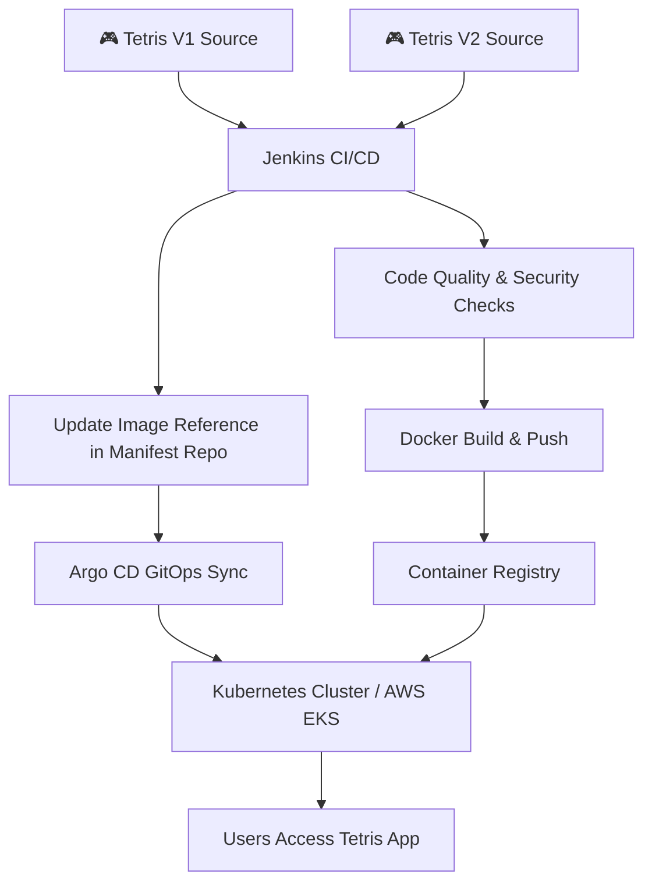

<div align="center">

# 🎮 Tetris DevSecOps — Kubernetes Manifests

### 🚀 Shared GitOps Deployment Repository for Tetris V1 & Tetris V2

**Kubernetes • Argo CD • Jenkins • Docker • GitOps**

[](https://kubernetes.io/)
[](https://argo-cd.readthedocs.io/)
[](https://github.com/abhisheksaste31-source/devsecops-Tetris-manifest)

</div>

## 📌 Overview

This repository is the **shared Kubernetes manifest and GitOps configuration repository for both Tetris V1 and Tetris V2**. Application source code is maintained in separate repositories, while this repository holds the Kubernetes YAML configuration used to deploy the selected application version.

> **Important:** This is **one manifest repository for both V1 and V2**, not a separate manifest repository for each version. The deployed version depends on the container image referenced in the active Deployment manifest.

## 🔗 Related Repositories

| Repository | Purpose |
|---|---|
| [🎮 Tetris V1](https://github.com/abhisheksaste31-source/devsecops-Tetris-V1) | React Tetris V1 application source |
| [🎮 Tetris V2](https://github.com/abhisheksaste31-source/devsecops-tetris-v2) | React Tetris V2 application source |
| [☸️ Tetris Manifest](https://github.com/abhisheksaste31-source/devsecops-Tetris-manifest) | Shared Kubernetes deployment configuration for V1 and V2 |

## 🏗️ Deployment Architecture



## ⚙️ GitOps Workflow

1. A change is pushed to the **Tetris V1** or **Tetris V2** source repository.
2. Jenkins runs the configured build, code-quality, and security stages.
3. Jenkins builds and pushes a versioned Docker image to the configured container registry.
4. The pipeline updates the `image:` reference in the Kubernetes Deployment YAML in **this shared manifest repository**.
5. Argo CD detects the Git change and synchronizes the desired state to Kubernetes.
6. Kubernetes rolls out the selected Tetris version.

**Note:** With a single active Deployment manifest, V1 and V2 are alternative deployed versions. To run both simultaneously, define separate Deployments and Services with unique names and selectors.

## 📁 Repository Structure

A typical manifest repository may contain:

```text
devsecops-Tetris-manifest/
├── README.md
└── deployment.yml       # Example filename — use the actual YAML filename in this repo
```

The example filename above is illustrative; update the commands below to match your committed manifest files.

## ☸️ Example Kubernetes Deployment & Service

The following is a **template**, not a claim about the repository's current YAML:

```yaml
apiVersion: apps/v1
kind: Deployment
metadata:
  name: tetris
spec:
  replicas: 2
  selector:
    matchLabels:
      app: tetris
  template:
    metadata:
      labels:
        app: tetris
    spec:
      containers:
        - name: tetris
          image: YOUR_DOCKERHUB_USERNAME/tetris-v1:YOUR_IMAGE_TAG
          ports:
            - containerPort: 3000
---
apiVersion: v1
kind: Service
metadata:
  name: tetris-service
spec:
  type: LoadBalancer
  selector:
    app: tetris
  ports:
    - port: 80
      targetPort: 3000
```

Replace the image, tag, and container port with the values used by your actual application and Dockerfile. To deploy V2, update the image reference to your V2 image and commit the change.

## 🚀 Manual Deployment

Prerequisites: a running Kubernetes cluster, `kubectl` configured for that cluster, and a published application image.

```bash
git clone https://github.com/abhisheksaste31-source/devsecops-Tetris-manifest.git
cd devsecops-Tetris-manifest

# Inspect the real manifest filenames before applying
ls -la

# Replace deployment.yml with the actual filename, if different
kubectl apply -f deployment.yml
kubectl get deployments
kubectl get pods
kubectl get services
kubectl rollout status deployment/tetris
```

## 🔄 Argo CD Configuration

Create an Argo CD application pointing to:

| Setting | Value |
|---|---|
| Repository URL | `https://github.com/abhisheksaste31-source/devsecops-Tetris-manifest.git` |
| Revision | `main` (if that is your default branch) |
| Path | `.` (if manifests are in the repository root) |
| Destination | Your Kubernetes cluster and target namespace |
| Sync policy | Automated, if continuous deployment is desired |

Argo CD monitors this manifest repository; it does not need to monitor both application source repositories directly.

## 🔐 Security & Delivery Tools

| Tool | Role |
|---|---|
| GitHub | Source and manifest version control |
| Jenkins | Build and manifest-update automation |
| SonarQube | Code quality analysis in application pipelines |
| OWASP Dependency-Check | Dependency vulnerability checks |
| Trivy | Filesystem and container image scanning |
| Docker | Container image packaging |
| Kubernetes / Amazon EKS | Container orchestration |
| Argo CD | GitOps continuous deployment |

These tools describe the intended end-to-end workflow; this manifest repository itself primarily stores deployment configuration.

## 🧪 Useful Commands

```bash
kubectl get pods -o wide
kubectl get deployments
kubectl get services
kubectl describe deployment tetris
kubectl rollout history deployment/tetris
kubectl logs deployment/tetris
```

## 👨‍💻 Author

**Abhishek Saste**  
[GitHub](https://github.com/abhisheksaste31-source) · [LinkedIn](https://www.linkedin.com/in/abhisheksaste)

---

<div align="center">

⭐ **One Manifest Repository • Two Tetris Versions • GitOps-Driven Kubernetes Deployment** ⭐

</div>
